# ztreamer v0.2.0 against lightwalletd and zingod

**ztreamer v0.2.0** (embedded zakura, and from its default snapshot), **lightwalletd v0.6.2**, **zingod v1.1.0** (from zakura, and from its snapshot)

| Headline | Result | Detail |
| --- | --- | --- |
| Empty index to serving | **2.8 min** | ztreamer direct · trees ready at 5.0 min · lightwalletd 84.3 min · zingod direct 11.6 min |
| From a snapshot | **11.6 min** | ztreamer snapshot · default source · zingod snapshot 20.9 min |
| Wallet download | **22.7 s** | ztreamer direct · lightwalletd 65.0 s · zingod direct 23.8 s |
| 10,000-block range, p50 | **4.74 ms** | ztreamer direct · lightwalletd 107 ms · zingod direct 8.35 ms |
| GetTreeState, p50 | **57 µs** | ztreamer direct · lightwalletd 222 ms · zingod direct 150 µs |
| Disk footprint | **17.72 GiB** | ztreamer index · lightwalletd 29.03 GiB · zingod 66.53 GiB |

## Summary

From an empty index, ztreamer v0.2.0 serves the whole chain after 2.8 minutes when it runs zakura in process, and its note commitment trees reach the tip 2.3 minutes later, at 5.0 minutes. lightwalletd v0.6.2 needs 1.41 hours from the same node. zingod v1.1.0 needs 11.6 minutes from the same node. From its snapshot, ztreamer serves after 11.6 minutes, limited by the download; zingod serves after 20.9 minutes from its snapshot, also limited by the download. Once synced, ztreamer serves about 1 M compact blocks/s from 16 clients, about 4 times the rate of lightwalletd, about the rate of zingod. ztreamer has the lowest latency for block ranges and the lowest tail latency under load. zingod answers the most GetTreeState requests under load. Its first-sync and catch-up sessions in zcash-walletsync-bench are the shortest. ztreamer serves the most wallets at once in cbb, without errors. ztreamer's index takes 17.7 GiB on disk; lightwalletd's cache takes 29.0 GiB; zingod's indexes take 66.5 GiB. With its default configuration, lightwalletd and its node refuse work above about 100 clients. With its default configuration, zingod refuses work above 128 clients from one address.

| Server | Empty index to serving | Trees ready | Wallet download | 10,000-block range p50 | 10-block range p50 | GetTreeState p50 | M blocks/s at 64 clients | Sync CPU s | Sync peak RSS | Disk | Restart to serving |
| --- | --- | --- | --- | --- | --- | --- | --- | --- | --- | --- | --- |
| ztreamer direct | 2.8 min | 5.0 min | 22.7 s | 4.74 ms | 39 µs | 57 µs | 1.04 | 2,403 | 9.21 GiB | 17.72 GiB | 46.2 s |
| ztreamer snapshot | 11.6 min | 11.6 min | 22.6 s | 5.12 ms | 56 µs | 53 µs | 1.07 | 2,733 | 5.40 GiB | 17.79 GiB | 2.1 s |
| lightwalletd | 84.3 min | – | 65.0 s | 107 ms | 296 µs | 222 ms | 0.27 | 10,248 | 1.13 GiB | 29.03 GiB | 1.1 s |
| zingod direct | 11.6 min | – | 23.8 s | 8.35 ms | 139 µs | 150 µs | 1.03 | 5,473 | 11.15 GiB | 66.53 GiB | 3.2 s |
| zingod snapshot | 20.9 min | – | 23.3 s | 7.42 ms | 135 µs | 55 µs | 1.04 | 60 | 2.20 GiB | 66.92 GiB | 2.1 s |

> Sync CPU and peak RSS add the standalone zakurad for every server but ztreamer direct, which runs zakura in its own process. Trees ready is when the note commitment trees of ztreamer reach the tip; the other servers have no such step (lightwalletd asks the node for each tree state, zingod builds its tree-state index during its sync).

- **Sync**: ztreamer direct served at 165 s (21,688 blocks/s) and had its trees at the tip at 301 s. lightwalletd took 5,059 s. zingod direct took 698 s. ztreamer from its snapshot took 695 s: an 18.2 GB import of 409 epochs from `snapshot.ztreamer.sh`, which ran at about 26 MB/s here. The imported trees were at the tip as soon as the import ended. zingod from its snapshot took 1,253 s: 44.9 GB downloaded and installed in 20 min 48 s, then the tail from height 3,544,662.
- **Sync cost**: ztreamer direct used 2,403 CPU seconds with a 9.21 GiB peak RSS; ztreamer from snapshot 2,733 (2,530 for ztreamerd); lightwalletd and its node 10,248 (2,444 for lightwalletd); zingod direct 5,473 (4,589 for zingod); zingod from snapshot 60.
- **Wallet download** (every compact block from Sapling activation, 3,145,415 blocks): 22.7 s on ztreamer direct, 22.6 s from snapshot, 65.0 s on lightwalletd, 23.8 s and 23.3 s on zingod.
- **Ranges**: the median 10,000-block GetBlockRange takes 4.7 ms on ztreamer direct, 107 ms on lightwalletd, 8.4 ms on zingod direct. The median 10-block range takes 39 µs on ztreamer direct, 296 µs on lightwalletd, 139 µs on zingod direct.
- **GetTreeState**: the median sequential request takes 57 µs on ztreamer direct, 222 ms on lightwalletd, which asks zakurad for each tree state, 150 µs on zingod direct. With 64 ghz workers, ztreamer answers 99,153 requests/s, lightwalletd 36, zingod 124,753.
- **Concurrency**: with 10,000-block requests at 64 clients, ztreamer direct serves 1.04 M blocks/s with a 3.2 s p99, lightwalletd 0.27 M with an 18.0 s p99, zingod direct 1.03 M with a 7.5 s p99. With 100-block requests, lightwalletd failed some requests at 128 and 256 clients. At 128 and 256 clients zingod refused connections, so those levels failed.
- **Wallet sessions** (zcash-walletsync-bench, median): a first sync of 10,000 blocks with the vizor profile took 0.45 s on ztreamer, 0.72 s on lightwalletd, 0.32 s on zingod. The transparent session took 0.31 s on ztreamer, 1.64 s on lightwalletd, 1.04 s on zingod. A one-week catch-up took 0.20 to 0.23 s on every server.
- **Wallets at once** (cbb, warm pass, 200 wallets, with GetTreeState): ztreamer 5,640 successful requests/s and no errors; lightwalletd 219/s, with 1,270 errors; zingod 4,115/s, with 7,773 of 12,000 requests refused. BlockRange only: 5,207/s on ztreamer, 1,097/s on lightwalletd, 3,363/s on zingod, with 8,840 of 10,000 refused.
- **Disk and restart**: ztreamer's index takes 17.7 GiB, lightwalletd's cache 29.0 GiB, zingod's indexes 66.5 GiB. A restart to serving takes 46 s on ztreamer direct, which opens the embedded zakura, and 2.1 s on ztreamer from snapshot; 1.1 s on lightwalletd; 2.1 to 3.2 s on zingod.

## Setup

|  | Value |
| --- | --- |
| CPU | AMD Ryzen 9 9950X3D · 16 cores / 32 threads · 128 MiB L3 |
| Memory | 60.4 GiB RAM · 32 GiB swap |
| Disk | WD_BLACK SN850X 2 TB NVMe · ext4 · index, cache and zakura state on the same disk |
| OS | Manjaro Linux · Linux 6.12.112 · x86_64 |
| CPU governor | powersave |
| ztreamer | ztreamerd 0.2.0 · commit `8c3d1e5cbe` · `maxperf` profile |
| zakura | zakurad 1.8.9+g23b79deda541 · commit `23b79deda5` (standalone node), the version embedded in ztreamerd 0.2.0 |
| lightwalletd | v0.6.2 · commit `f8fe2cca7e` · Go build, default flags |
| zingod | zingod 1.1.0 · commit `bfce8b2b43` · release build, `generate-config` defaults |
| Wallet benchmarks | <a href="https://github.com/zcashlabs/zcash-walletsync-bench">zcash-walletsync-bench</a> commit `40641f1d68`, before its first public commit `c2970fe074`, which measures the same way (standard `suite`, default profiles and repetitions, soak off) · cbb commit `6dffa2e9ad` (50, 100, 150 and 200 wallets, cold and warm pass) |
| Chain | zakura Mainnet state in format 31 with the fast-sync (VCT) marker restored, brought to the live tip before each run: node tip 3,587,082 at the start of the first run, 3,587,856 at the start of the last |
| Serving interval | 419,200 to 3,564,614, fixed for every server |
| Clients | native Rust/Tonic serving suite of this repository · ghz · zcash-walletsync-bench · cbb · loopback, plaintext HTTP/2 |

Each server ran alone on the host, in this order: ztreamer direct, ztreamer snapshot, lightwalletd, zingod direct, zingod snapshot. Every run started from an empty index or data directory. The standalone zakurad started on the same state and was brought to the live tip before each server started, so no server timed the catch-up of its node. All servers then served the same fixed interval with the same seeded request sequences.

- **ztreamer direct**: `ztreamerd --zakura-config`, empty index. The zakura node runs in the ztreamerd process and the index reads its state directly. After the block sync, ztreamer builds its note commitment trees.
- **ztreamer snapshot**: `ztreamerd --remote-rpc` against the standalone zakurad, empty index. It imports the sealed ranges and their tree rows from the default snapshot source, `https://snapshot.ztreamer.sh/mainnet`, has the node attest them, and then reads the tail over JSON-RPC.
- **lightwalletd**: v0.6.2 against the standalone zakurad over JSON-RPC, with `--no-tls-very-insecure` and default limits. It builds its compact-block cache from genesis.
- **zingod direct**: v1.1.0 with the `generate-config` defaults and the standalone zakurad as its one trusted validator (`legacy_rpc`), empty data directory. It builds every index from the node.
- **zingod snapshot**: as zingod direct, with `[snapshot] manifest = "https://snapshots.zingolabs.dev/zingod-snapshot-1.0.0/manifest.json"` (height 3,544,662). It installs the snapshot, then syncs the tail from the node.

> One run of each server. The client shared the host with the server, and other work ran on the host: the load average at the start of the runs was between 2.1 and 17.4, mostly from the previous run, because the runs went back to back. The runs went in the order of the tables, so the page cache held whatever the previous run had read. The node followed the live chain, so its tip moved between runs (3,587,082 to 3,587,856), but every historical request was in the fixed interval. The zakura state comes from an earlier benchmark on this host, with its fast-sync (VCT) marker restored; that benchmark had removed the marker for a frontier test. Every run reused this one state, upgraded once to format 31. No pristine copy was restored before each run, because the disk could not hold a second copy, so the state followed the tip from run to run. While ztreamer direct built its trees, a helper binary of the harness compiled at nice 19. The soak scenario of zcash-walletsync-bench was dropped after the first wallet run; its tip-follow scenario stayed. The snapshot manifest URL in the zingod README (`/mainnet/manifest.json`) returned 404, so the run used the published 1.0.0 manifest. The second drive was not mounted, so no index was moved off the system disk. The throughput of ghz for streaming RPCs is limited by ghz itself; the native suite gives the server limits.

## Sync speed

Time from the start of the server process until its index has the tip of the synced node and its gRPC listener accepts connections. For zingod, synced means `/status` reports the served tip within one block of the node.

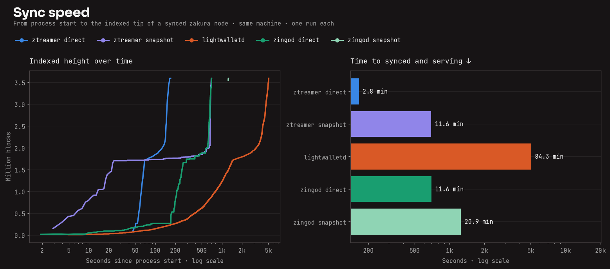

| Server | Time to tip | Tip | Blocks / s | CPU s | Mean cores | Peak RSS | Disk read | Disk written |
| --- | --- | --- | --- | --- | --- | --- | --- | --- |
| ztreamer direct | 2.8 min | 3,587,080 | 21,688 | 2,403 | 14.5 | 9.21 GiB | 386.12 GiB | 27.02 GiB |
| ztreamer snapshot | 11.6 min | 3,587,239 | 5,162 | 2,733 | 3.9 | 5.40 GiB | 12.60 GiB | 35.91 GiB |
| lightwalletd | 84.3 min | 3,587,518 | 709 | 10,248 | 2.0 | 1.13 GiB | 254.79 GiB | 29.06 GiB |
| zingod direct | 11.6 min | 3,586,679 | 5,140 | 5,473 | 7.8 | 11.15 GiB | 307.07 GiB | 140.96 GiB |
| zingod snapshot | 20.9 min | 3,586,820 | 2,863 | 60 | 0.0 | 2.20 GiB | 41.58 GiB | 109.45 GiB |

ztreamer direct is the only server that reads the node state in process: it read 386 GiB from disk in 165 s. The sync of lightwalletd and zingod direct goes through the JSON-RPC of the node. The ztreamer snapshot run is bound by the download: it imported 18.2 GB in 692 s; so is the zingod snapshot run, which downloaded and installed 44.9 GB in 20 min 48 s. An earlier run on this host imported the same snapshot at about 54 MB/s; here the import ran at about 26 MB/s. The trees phase of ztreamer direct is the time from the end of the block sync until the trees of the index reach its durable tip.

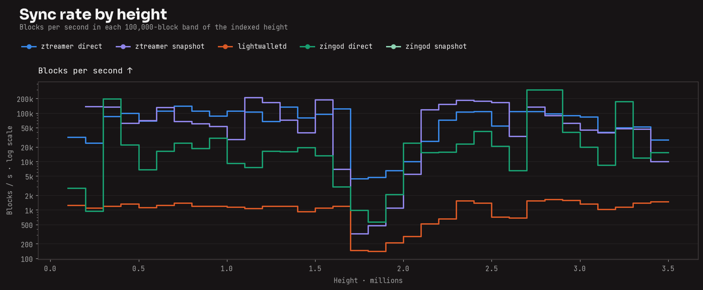

| Server | Milestone | After | Height |
| --- | --- | --- | --- |
| ztreamer direct | historical pass complete | 2.7 min | 3,586,090 |
| ztreamer direct | gRPC listener open | 2.7 min | – |
| ztreamer direct | note commitment trees at the tip | 5.0 min | – |
| ztreamer snapshot | import planned | 1.2 s | – |
| ztreamer snapshot | import complete | 11.6 min | – |
| ztreamer snapshot | gRPC listener open | 11.6 min | – |
| ztreamer snapshot | note commitment trees at the tip | 11.6 min | – |

## Snapshot against direct

A snapshot run starts from a published snapshot and then follows the standalone zakurad. ztreamer's snapshot carries the sealed ranges and their tree rows, so its trees are at the tip as soon as the import is done. zingod's snapshot carries all six indexes up to height 3,544,662, and zingod syncs the remaining tail from the node. On this host and network, a direct sync was faster than a snapshot: 165 s against 695 s for ztreamer, and 698 s against 1,253 s for zingod. A snapshot reads much less from disk and needs no local node state up front. Once synced, the snapshot runs serve at the speed of the direct runs.

| Server | Time to tip | First indexed height | CPU s (with node) | Server CPU s | Server peak RSS | Disk read | Disk written | Disk | Restart | 10,000-block p50 | Wallet download |
| --- | --- | --- | --- | --- | --- | --- | --- | --- | --- | --- | --- |
| ztreamer direct | 2.8 min | 87,718 | 2,403 | 2,403 | 9.21 GiB | 386.12 GiB | 27.02 GiB | 17.72 GiB | 46.2 s | 4.74 ms | 22.7 s |
| ztreamer snapshot | 11.6 min | 146,999 | 2,733 | 2,530 | 4.39 GiB | 12.60 GiB | 35.91 GiB | 17.79 GiB | 2.1 s | 5.12 ms | 22.6 s |
| zingod direct | 11.6 min | 12,056 | 5,473 | 4,589 | 10.00 GiB | 307.07 GiB | 140.96 GiB | 66.53 GiB | 3.2 s | 8.35 ms | 23.8 s |
| zingod snapshot | 20.9 min | 3,544,662 | 60 | 52 | 1.30 GiB | 41.58 GiB | 109.45 GiB | 66.92 GiB | 2.1 s | 7.42 ms | 23.3 s |

## Resource use

A sampler read `/proc` once a second for each process: CPU time, resident memory and disk bytes. For every server but ztreamer direct the totals include the standalone zakurad, which they need; in the direct run the node is inside ztreamerd.

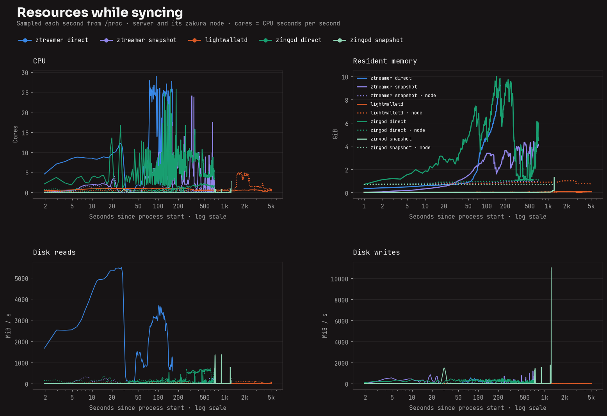

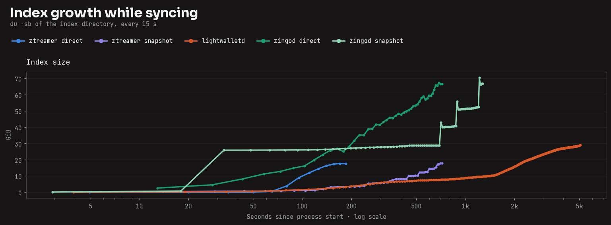

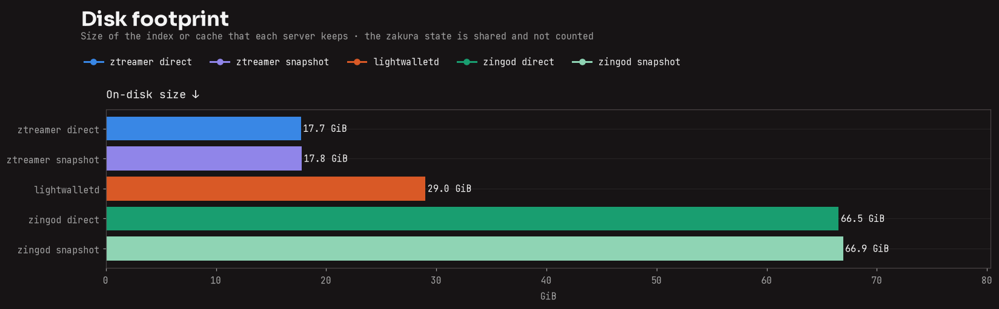

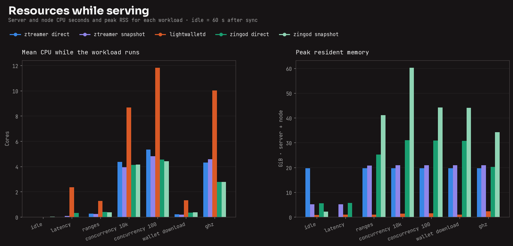

| Server | Workload | Duration | CPU s | Mean cores | Peak RSS |
| --- | --- | --- | --- | --- | --- |
| ztreamer direct | idle | 60.0 s | 0.5 | 0.01 | 19.66 GiB |
| ztreamer direct | ranges | 116.1 s | 30.2 | 0.26 | 19.67 GiB |
| ztreamer direct | concurrency 10k | 2.6 min | 682.7 | 4.37 | 19.69 GiB |
| ztreamer direct | concurrency 100 | 2.0 min | 654.1 | 5.34 | 19.70 GiB |
| ztreamer direct | wallet download | 23.0 s | 5.0 | 0.22 | 19.69 GiB |
| ztreamer direct | ghz | 11.9 min | 3,082.3 | 4.31 | 19.73 GiB |
| ztreamer snapshot | idle | 60.0 s | 0.3 | 0.01 | 5.17 GiB |
| ztreamer snapshot | ranges | 118.2 s | 30.0 | 0.25 | 20.83 GiB |
| ztreamer snapshot | concurrency 10k | 2.6 min | 620.4 | 3.94 | 20.91 GiB |
| ztreamer snapshot | concurrency 100 | 2.0 min | 589.2 | 4.82 | 20.88 GiB |
| ztreamer snapshot | wallet download | 23.0 s | 4.6 | 0.20 | 20.88 GiB |
| ztreamer snapshot | ghz | 11.8 min | 3,234.9 | 4.59 | 20.88 GiB |
| lightwalletd | idle | 60.0 s | 0.1 | 0.00 | 0.87 GiB |
| lightwalletd | ranges | 6.3 min | 480.5 | 1.28 | 0.96 GiB |
| lightwalletd | concurrency 10k | 3.9 min | 2,039.4 | 8.67 | 1.40 GiB |
| lightwalletd | concurrency 100 | 2.0 min | 1,442.3 | 11.80 | 1.44 GiB |
| lightwalletd | wallet download | 65.1 s | 86.5 | 1.33 | 1.00 GiB |
| lightwalletd | ghz | 11.7 min | 7,066.3 | 10.03 | 2.27 GiB |
| zingod direct | idle | 60.0 s | 0.7 | 0.01 | 5.61 GiB |
| zingod direct | ranges | 2.1 min | 49.9 | 0.41 | 25.25 GiB |
| zingod direct | concurrency 10k | 104.2 s | 429.0 | 4.12 | 31.03 GiB |
| zingod direct | concurrency 100 | 81.2 s | 369.2 | 4.55 | 30.90 GiB |
| zingod direct | wallet download | 24.0 s | 8.2 | 0.34 | 30.74 GiB |
| zingod direct | ghz | 11.8 min | 1,966.7 | 2.79 | 20.16 GiB |
| zingod snapshot | idle | 60.0 s | 1.3 | 0.02 | 2.18 GiB |
| zingod snapshot | ranges | 2.0 min | 44.1 | 0.37 | 41.06 GiB |
| zingod snapshot | concurrency 10k | 105.2 s | 436.0 | 4.14 | 60.15 GiB |
| zingod snapshot | concurrency 100 | 81.2 s | 359.4 | 4.43 | 44.15 GiB |
| zingod snapshot | wallet download | 24.0 s | 8.7 | 0.36 | 44.07 GiB |
| zingod snapshot | ghz | 11.8 min | 1,961.0 | 2.78 | 34.16 GiB |

**Serving efficiency**: compact blocks served per CPU second of the server and its node, in the workloads that serve blocks.

| Workload | ztreamer direct blocks / CPU s | ztreamer snapshot blocks / CPU s | lightwalletd blocks / CPU s | zingod direct blocks / CPU s | zingod snapshot blocks / CPU s |
| --- | --- | --- | --- | --- | --- |
| ranges | 698,544 | 703,432 | 43,930 | 422,623 | 478,685 |
| concurrency 10k | 155,670 | 179,207 | 17,554 | 141,958 | 140,049 |
| concurrency 100 | 131,615 | 157,584 | 16,969 | 129,210 | 137,699 |
| wallet download | 631,609 | 683,786 | 36,380 | 383,587 | 360,300 |

ztreamer serves blocks from memory-mapped files, and so does zingod. Its RSS under load is mostly file-backed pages of the index, which the kernel can drop. lightwalletd keeps a small heap, but in the 10,000-block concurrency suite it spends 8 to 10 times more CPU for each block it serves than ztreamer.

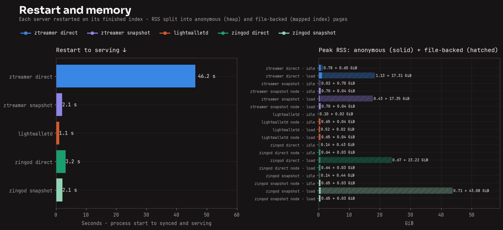

| Server | Process | When | Anonymous | File-backed | RSS |
| --- | --- | --- | --- | --- | --- |
| ztreamer direct | server | idle | 0.78 GiB | 0.65 GiB | 1.43 GiB |
| ztreamer direct | server | load | 1.13 GiB | 17.31 GiB | 18.45 GiB |
| ztreamer snapshot | server | idle | 0.02 GiB | 0.70 GiB | 0.72 GiB |
| ztreamer snapshot | server | load | 0.43 GiB | 17.35 GiB | 17.78 GiB |
| ztreamer snapshot | zakurad node | idle | 0.70 GiB | 0.04 GiB | 0.73 GiB |
| ztreamer snapshot | zakurad node | load | 0.70 GiB | 0.04 GiB | 0.74 GiB |
| lightwalletd | server | idle | 0.10 GiB | 0.02 GiB | 0.12 GiB |
| lightwalletd | server | load | 0.52 GiB | 0.02 GiB | 0.54 GiB |
| lightwalletd | zakurad node | idle | 0.65 GiB | 0.04 GiB | 0.68 GiB |
| lightwalletd | zakurad node | load | 0.65 GiB | 0.04 GiB | 0.69 GiB |
| zingod direct | server | idle | 0.14 GiB | 0.43 GiB | 0.58 GiB |
| zingod direct | server | load | 0.67 GiB | 23.22 GiB | 23.89 GiB |
| zingod direct | zakurad node | idle | 0.64 GiB | 0.03 GiB | 0.67 GiB |
| zingod direct | zakurad node | load | 0.64 GiB | 0.03 GiB | 0.68 GiB |
| zingod snapshot | server | idle | 0.14 GiB | 0.44 GiB | 0.57 GiB |
| zingod snapshot | server | load | 0.71 GiB | 43.08 GiB | 43.79 GiB |
| zingod snapshot | zakurad node | idle | 0.65 GiB | 0.03 GiB | 0.68 GiB |
| zingod snapshot | zakurad node | load | 0.65 GiB | 0.03 GiB | 0.69 GiB |

| Server | Restart to serving | Wallet download after restart | M blocks / s at 64 clients after restart |
| --- | --- | --- | --- |
| ztreamer direct | 46.2 s | 22.6 s | 1.06 |
| ztreamer snapshot | 2.1 s | 22.6 s | 1.08 |
| lightwalletd | 1.1 s | 65.2 s | 0.27 |
| zingod direct | 3.2 s | 22.9 s | 1.05 |
| zingod snapshot | 2.1 s | 24.5 s | 1.01 |

Restart: stop the server after its run, start it on the same index, and time it until it serves a request. ztreamer direct also opens the embedded zakura state, which takes most of its 46 s.

## Serving overview

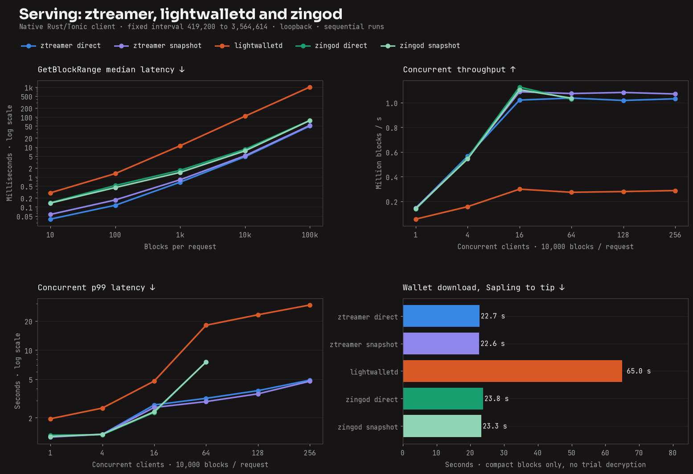

lightwalletd is slower than ztreamer on block ranges and on GetTreeState, which it forwards to zakurad. ztreamer and zingod are close on bulk block serving. ztreamer is faster on block ranges and GetBlock and has the lower tail latency under load; zingod is faster on GetSubtreeRoots and answers more GetTreeState requests under load.

## RPC latencies

500 sequential requests per case from one client, after one warmup. Completion time includes draining the stream and decoding. Address cases use a busy and a quiet transparent address over the whole interval; GetTransaction uses two fixed transactions.

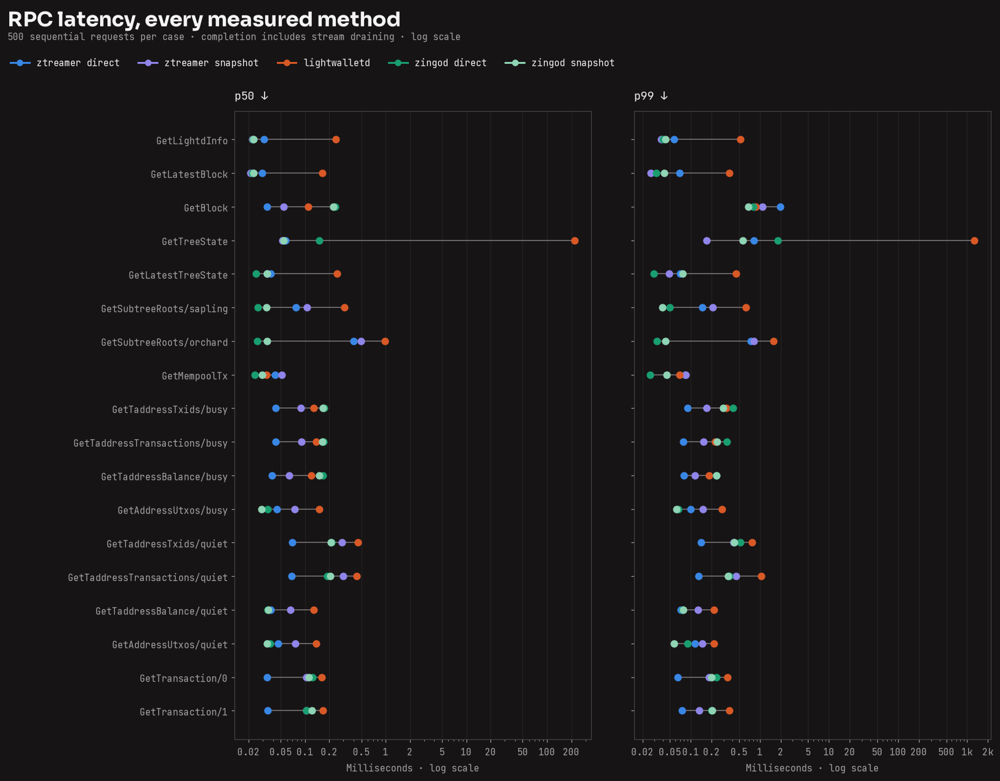

| Case | ztreamer direct p50 | ztreamer snapshot p50 | lightwalletd p50 | zingod direct p50 | zingod snapshot p50 |
| --- | --- | --- | --- | --- | --- |
| GetLightdInfo | 31 µs | 22 µs | 240 µs | 22 µs | 23 µs |
| GetLatestBlock | 30 µs | 21 µs | 163 µs | 22 µs | 23 µs |
| GetBlock | 34 µs | 54 µs | 109 µs | 239 µs | 225 µs |
| GetTreeState | 57 µs | 53 µs | 222 ms | 150 µs | 55 µs |
| GetLatestTreeState | 38 µs | 34 µs | 248 µs | 25 µs | 34 µs |
| GetSubtreeRoots/sapling | 77 µs | 106 µs | 306 µs | 26 µs | 34 µs |
| GetSubtreeRoots/orchard | 400 µs | 493 µs | 981 µs | 26 µs | 34 µs |
| GetMempoolTx | 43 µs | 52 µs | 33 µs | 24 µs | 29 µs |
| GetTaddressTxids/busy | 43 µs | 89 µs | 129 µs | 172 µs | 166 µs |
| GetTaddressTransactions/busy | 44 µs | 90 µs | 138 µs | 170 µs | 164 µs |
| GetTaddressBalance/busy | 39 µs | 63 µs | 120 µs | 167 µs | 150 µs |
| GetAddressUtxos/busy | 45 µs | 74 µs | 150 µs | 34 µs | 29 µs |
| GetTaddressTxids/quiet | 70 µs | 286 µs | 452 µs | 213 µs | 210 µs |
| GetTaddressTransactions/quiet | 68 µs | 296 µs | 438 µs | 188 µs | 206 µs |
| GetTaddressBalance/quiet | 38 µs | 66 µs | 128 µs | 34 µs | 35 µs |
| GetAddressUtxos/quiet | 46 µs | 76 µs | 138 µs | 37 µs | 34 µs |
| GetTransaction/0 | 34 µs | 104 µs | 162 µs | 124 µs | 111 µs |
| GetTransaction/1 | 34 µs | 103 µs | 166 µs | 104 µs | 122 µs |

| Case | ztreamer direct p99 | ztreamer snapshot p99 | lightwalletd p99 | zingod direct p99 | zingod snapshot p99 |
| --- | --- | --- | --- | --- | --- |
| GetLightdInfo | 58 µs | 38 µs | 524 µs | 40 µs | 43 µs |
| GetLatestBlock | 69 µs | 26 µs | 364 µs | 31 µs | 41 µs |
| GetBlock | 1.96 ms | 1.10 ms | 877 µs | 807 µs | 682 µs |
| GetTreeState | 811 µs | 168 µs | 1.28 s | 1.83 ms | 562 µs |
| GetLatestTreeState | 70 µs | 48 µs | 456 µs | 29 µs | 77 µs |
| GetSubtreeRoots/sapling | 147 µs | 210 µs | 630 µs | 50 µs | 39 µs |
| GetSubtreeRoots/orchard | 739 µs | 825 µs | 1.59 ms | 32 µs | 43 µs |
| GetMempoolTx | 83 µs | 85 µs | 69 µs | 26 µs | 45 µs |
| GetTaddressTxids/busy | 90 µs | 169 µs | 324 µs | 411 µs | 297 µs |
| GetTaddressTransactions/busy | 77 µs | 154 µs | 223 µs | 333 µs | 239 µs |
| GetTaddressBalance/busy | 79 µs | 115 µs | 186 µs | 236 µs | 236 µs |
| GetAddressUtxos/busy | 99 µs | 149 µs | 280 µs | 66 µs | 63 µs |
| GetTaddressTxids/quiet | 140 µs | 414 µs | 772 µs | 525 µs | 424 µs |
| GetTaddressTransactions/quiet | 131 µs | 456 µs | 1.05 ms | 360 µs | 345 µs |
| GetTaddressBalance/quiet | 72 µs | 127 µs | 217 µs | 76 µs | 78 µs |
| GetAddressUtxos/quiet | 115 µs | 147 µs | 216 µs | 90 µs | 57 µs |
| GetTransaction/0 | 65 µs | 184 µs | 338 µs | 233 µs | 199 µs |
| GetTransaction/1 | 75 µs | 132 µs | 364 µs | 201 µs | 204 µs |

## Range sizes

GetBlockRange over 1,000 seeded random ranges per size (100 at 100,000 blocks), one client, sequential.

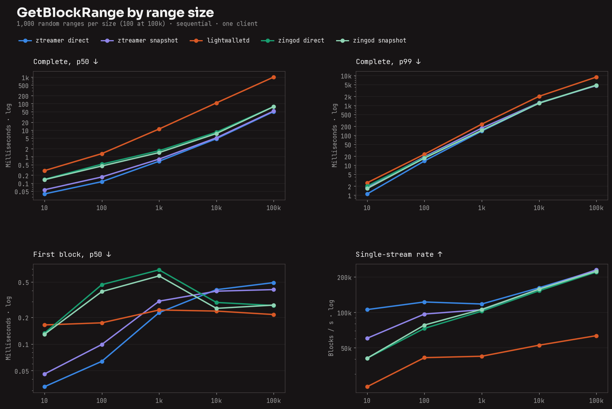

| Range | ztreamer direct p50 | ztreamer snapshot p50 | lightwalletd p50 | zingod direct p50 | zingod snapshot p50 |
| --- | --- | --- | --- | --- | --- |
| 10 blocks | 39 µs | 56 µs | 296 µs | 139 µs | 135 µs |
| 100 blocks | 114 µs | 171 µs | 1.30 ms | 519 µs | 443 µs |
| 1,000 blocks | 672 µs | 808 µs | 11.02 ms | 1.66 ms | 1.42 ms |
| 10,000 blocks | 4.74 ms | 5.12 ms | 107 ms | 8.35 ms | 7.42 ms |
| 100,000 blocks | 50.20 ms | 52.56 ms | 1.00 s | 77.49 ms | 76.78 ms |

| Range | ztreamer direct p99 | ztreamer snapshot p99 | lightwalletd p99 | zingod direct p99 | zingod snapshot p99 |
| --- | --- | --- | --- | --- | --- |
| 10 blocks | 1.10 ms | 1.85 ms | 2.60 ms | 2.00 ms | 1.66 ms |
| 100 blocks | 13.88 ms | 19.18 ms | 23.31 ms | 18.10 ms | 17.20 ms |
| 1,000 blocks | 139 ms | 174 ms | 235 ms | 147 ms | 146 ms |
| 10,000 blocks | 1.18 s | 1.22 s | 2.00 s | 1.21 s | 1.18 s |
| 100,000 blocks | 4.61 s | 4.56 s | 8.79 s | 4.71 s | 4.71 s |

## Concurrent serving

Closed loop: each client keeps one GetBlockRange outstanding for 20 s per level, on its own connection. Two request sizes: 10,000 blocks (a wallet catching up) and 100 blocks (a wallet that is nearly synced). A level fails when any request fails; its throughput is then not counted.

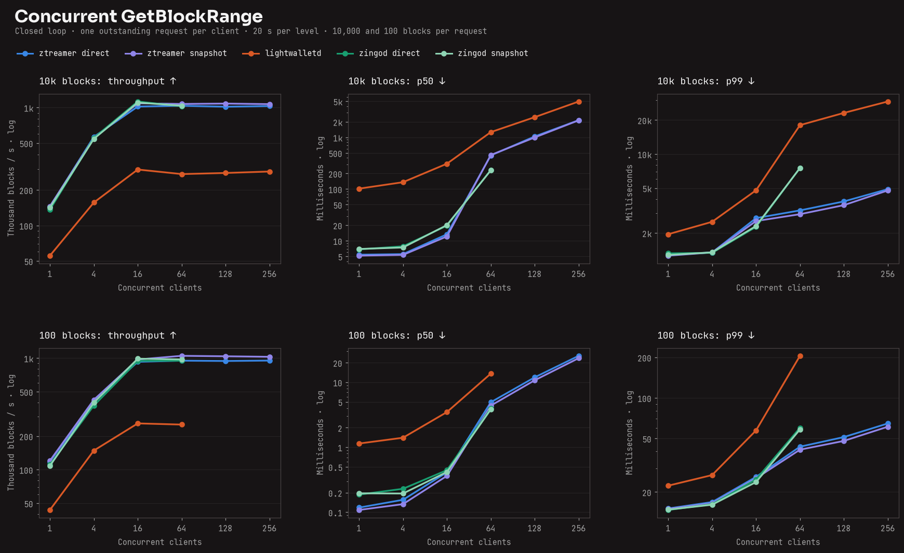

**10,000 blocks per request**: M blocks / s and p99 completion time

| Clients | ztreamer direct M blocks/s | ztreamer direct p99 | ztreamer snapshot M blocks/s | ztreamer snapshot p99 | lightwalletd M blocks/s | lightwalletd p99 | zingod direct M blocks/s | zingod direct p99 | zingod snapshot M blocks/s | zingod snapshot p99 |
| --- | --- | --- | --- | --- | --- | --- | --- | --- | --- | --- |
| 1 | 0.144 | 1.28 s | 0.146 | 1.26 s | 0.055 | 1.95 s | 0.136 | 1.32 s | 0.142 | 1.28 s |
| 4 | 0.565 | 1.34 s | 0.553 | 1.35 s | 0.157 | 2.51 s | 0.553 | 1.33 s | 0.543 | 1.35 s |
| 16 | 1.020 | 2.71 s | 1.087 | 2.55 s | 0.298 | 4.78 s | 1.126 | 2.27 s | 1.104 | 2.31 s |
| 64 | 1.036 | 3.17 s | 1.073 | 2.94 s | 0.273 | 18.04 s | 1.026 | 7.53 s | 1.036 | 7.53 s |
| 128 | 1.017 | 3.81 s | 1.082 | 3.53 s | 0.279 | 23.14 s | <em>warmup_failed</em> | – | <em>warmup_failed</em> | – |
| 256 | 1.030 | 4.89 s | 1.070 | 4.76 s | 0.287 | 29.19 s | <em>warmup_failed</em> | – | <em>warmup_failed</em> | – |

**100 blocks per request**: M blocks / s and p99 completion time

| Clients | ztreamer direct M blocks/s | ztreamer direct p99 | ztreamer snapshot M blocks/s | ztreamer snapshot p99 | lightwalletd M blocks/s | lightwalletd p99 | zingod direct M blocks/s | zingod direct p99 | zingod snapshot M blocks/s | zingod snapshot p99 |
| --- | --- | --- | --- | --- | --- | --- | --- | --- | --- | --- |
| 1 | 0.119 | 15.10 ms | 0.120 | 14.98 ms | 0.044 | 22.30 ms | 0.111 | 14.72 ms | 0.108 | 14.79 ms |
| 4 | 0.406 | 16.84 ms | 0.424 | 16.52 ms | 0.148 | 26.73 ms | 0.376 | 16.25 ms | 0.399 | 16.10 ms |
| 16 | 0.928 | 25.90 ms | 0.974 | 25.30 ms | 0.260 | 57.37 ms | 0.946 | 24.80 ms | 0.990 | 23.71 ms |
| 64 | 0.950 | 43.42 ms | 1.050 | 41.27 ms | 0.254 | 205 ms | 0.949 | 59.98 ms | 0.975 | 58.33 ms |
| 128 | 0.944 | 51.20 ms | 1.040 | 47.94 ms | <em>failed</em> (20 errors) | – | <em>warmup_failed</em> | – | <em>warmup_failed</em> | – |
| 256 | 0.952 | 64.61 ms | 1.029 | 61.12 ms | <em>failed</em> (138 errors) | – | <em>warmup_failed</em> | – | <em>warmup_failed</em> | – |

> zingod's connection limit is per client address. Its default `max_connections_per_ip` is 128, and every client of this benchmark connects from 127.0.0.1, so a level of 128 or more clients goes over it. Real deployments spread wallets over many addresses. lightwalletd answered "too many requests being received at once; retry shortly" at 128 and 256 clients.

## Wallet download

One client downloads every compact block from Sapling activation to the end of the interval, 10,000 blocks per request. This is the network part of a new wallet's first sync; it excludes trial decryption, scanning and storage.

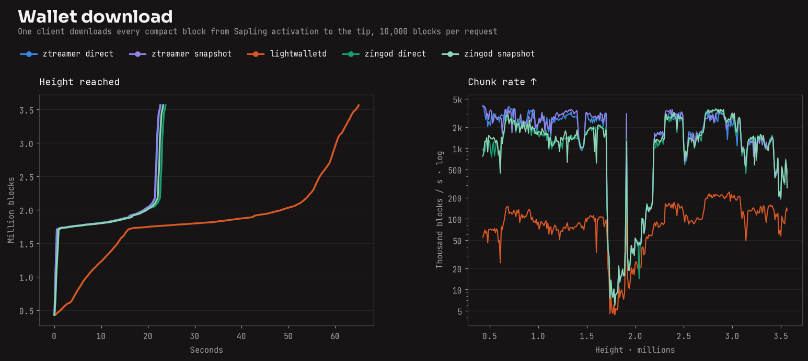

| Server | Time | Blocks | Protobuf bytes | Blocks / s |
| --- | --- | --- | --- | --- |
| ztreamer direct | 22.7 s | 3,145,415 | 16.66 GiB | 138,567 |
| ztreamer snapshot | 22.6 s | 3,145,415 | 16.66 GiB | 139,010 |
| lightwalletd | 65.0 s | 3,145,415 | 16.66 GiB | 48,369 |
| zingod direct | 23.8 s | 3,145,415 | 16.67 GiB | 132,412 |
| zingod snapshot | 23.3 s | 3,145,415 | 16.67 GiB | 135,238 |

## Throughput per RPC

ghz drives one RPC at a time with 1, 16, 64 and 256 concurrent workers, one connection each, for 15 s per level. Requests with heights cycle through 5,000 seeded random heights. The first request of each worker is not counted. Throughput counts successful requests only.

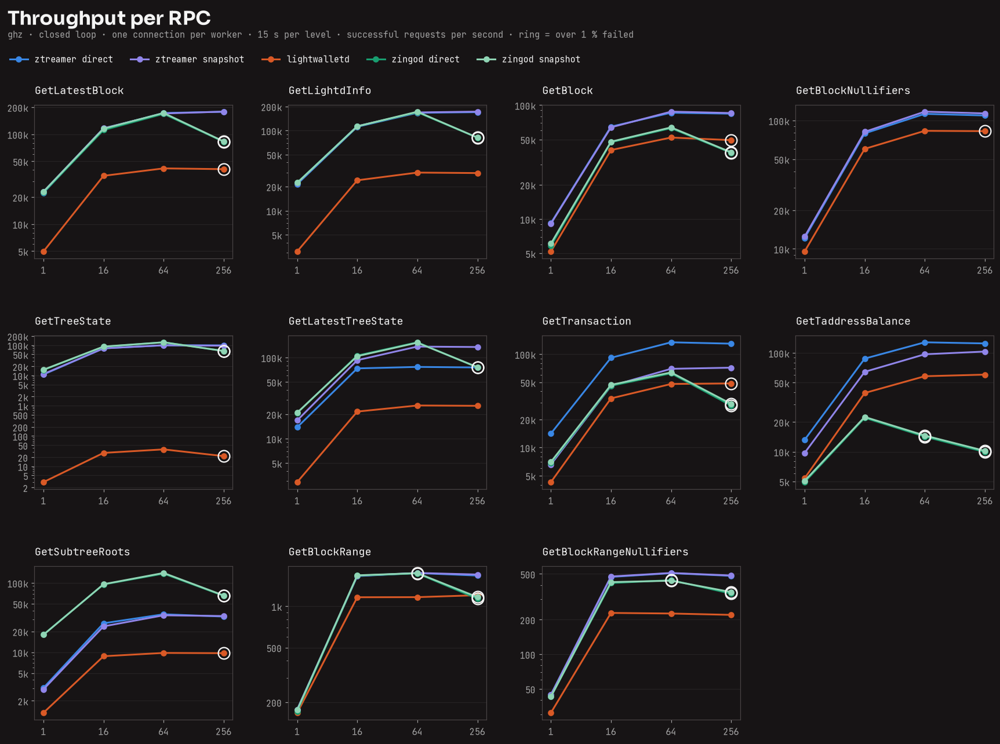

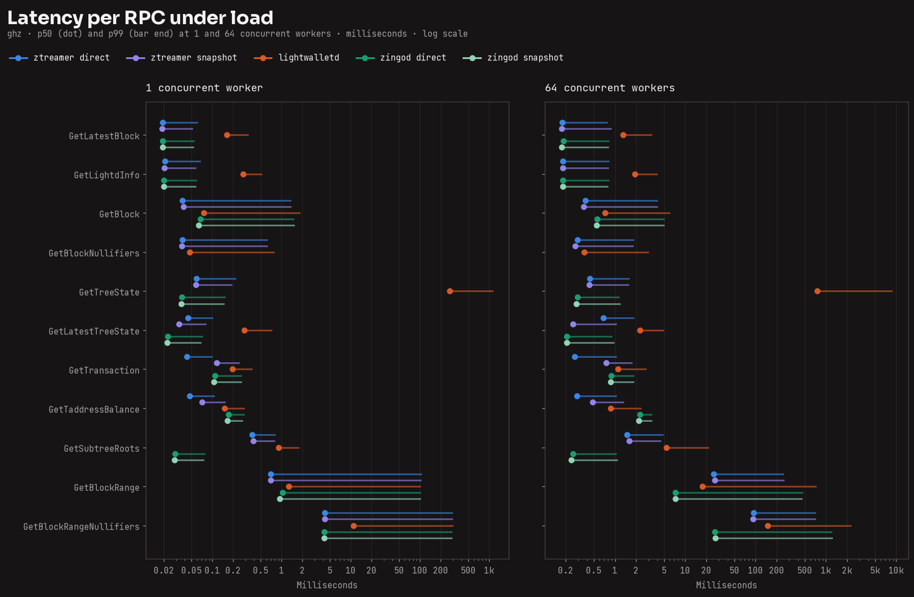

| RPC | Workers | ztreamer direct req/s | ztreamer direct p50 | ztreamer direct errors | ztreamer snapshot req/s | ztreamer snapshot p50 | ztreamer snapshot errors | lightwalletd req/s | lightwalletd p50 | lightwalletd errors | zingod direct req/s | zingod direct p50 | zingod direct errors | zingod snapshot req/s | zingod snapshot p50 | zingod snapshot errors |
| --- | --- | --- | --- | --- | --- | --- | --- | --- | --- | --- | --- | --- | --- | --- | --- | --- |
| GetBlock | 1 | 9,227 | 37 µs | 0 | 9,129 | 38 µs | 0 | 5,198 | 75 µs | 0 | 5,835 | 67 µs | 0 | 6,089 | 63 µs | 0 |
| GetBlock | 16 | 64,789 | 88 µs | 2 | 63,887 | 87 µs | 0 | 40,357 | 157 µs | 0 | 47,287 | 134 µs | 0 | 47,788 | 132 µs | 0 |
| GetBlock | 64 | 85,829 | 380 µs | 0 | 87,747 | 362 µs | 0 | 51,956 | 720 µs | 6,205 | 62,838 | 559 µs | 0 | 63,785 | 549 µs | 1 |
| GetBlock | 256 | 84,157 | 2.01 ms | 0 | 85,281 | 1.97 ms | 0 | 49,324 | 2.67 ms | 48,382 | 38,175 | 1.39 ms | 1,587,620 | 38,566 | 1.37 ms | 1,615,788 |
| GetBlockNullifiers | 1 | 12,141 | 37 µs | 1 | 12,452 | 36 µs | 0 | 9,548 | 47 µs | 0 | 0 | – | 365,648 | 0 | – | 366,147 |
| GetBlockNullifiers | 16 | 79,440 | 84 µs | 0 | 81,677 | 83 µs | 0 | 60,156 | 112 µs | 0 | 0 | – | 1,956,961 | 0 | – | 1,946,231 |
| GetBlockNullifiers | 64 | 112,741 | 293 µs | 12 | 117,343 | 272 µs | 0 | 83,144 | 369 µs | 320 | 0 | – | 2,986,498 | 0 | – | 3,021,008 |
| GetBlockNullifiers | 256 | 109,507 | 1.61 ms | 85 | 113,677 | 1.54 ms | 0 | 82,684 | 1.47 ms | 35,034 | 0 | – | 3,590,790 | 0 | – | 3,598,859 |
| GetBlockRange | 1 | 177 | 692 µs | 0 | 177 | 697 µs | 0 | 167 | 1.26 ms | 0 | 171 | 1.04 ms | 0 | 175 | 945 µs | 0 |
| GetBlockRange | 16 | 1,658 | 1.13 ms | 0 | 1,666 | 1.12 ms | 0 | 1,163 | 3.01 ms | 0 | 1,673 | 1.21 ms | 0 | 1,680 | 1.18 ms | 0 |
| GetBlockRange | 64 | 1,745 | 25.57 ms | 0 | 1,748 | 26.17 ms | 0 | 1,164 | 17.40 ms | 0 | 1,735 | 7.23 ms | 22,546 | 1,743 | 7.19 ms | 21,212 |
| GetBlockRange | 256 | 1,673 | 145 ms | 0 | 1,703 | 142 ms | 0 | 1,203 | 28.35 ms | 0 | 1,135 | 4.70 ms | 1,313,458 | 1,166 | 4.60 ms | 1,324,151 |
| GetBlockRangeNullifiers | 1 | 44 | 4.23 ms | 0 | 44 | 4.23 ms | 0 | 31 | 11.05 ms | 0 | 43 | 4.16 ms | 0 | 43 | 4.15 ms | 0 |
| GetBlockRangeNullifiers | 16 | 471 | 7.44 ms | 0 | 475 | 7.30 ms | 0 | 229 | 33.25 ms | 0 | 416 | 7.67 ms | 0 | 424 | 7.41 ms | 0 |
| GetBlockRangeNullifiers | 64 | 507 | 93.78 ms | 0 | 510 | 92.34 ms | 0 | 226 | 149 ms | 0 | 441 | 26.20 ms | 58,484 | 436 | 26.60 ms | 56,283 |
| GetBlockRangeNullifiers | 256 | 481 | 493 ms | 0 | 485 | 489 ms | 0 | 220 | 696 ms | 0 | 337 | 28.16 ms | 934,428 | 348 | 26.85 ms | 935,874 |
| GetLatestBlock | 1 | 22,293 | 19 µs | 0 | 22,984 | 19 µs | 0 | 4,964 | 163 µs | 0 | 22,516 | 19 µs | 0 | 22,919 | 19 µs | 0 |
| GetLatestBlock | 16 | 114,863 | 55 µs | 0 | 116,537 | 54 µs | 0 | 34,469 | 367 µs | 0 | 111,381 | 59 µs | 0 | 115,189 | 56 µs | 0 |
| GetLatestBlock | 64 | 172,273 | 178 µs | 0 | 170,243 | 174 µs | 0 | 41,685 | 1.30 ms | 20 | 168,607 | 185 µs | 0 | 172,456 | 176 µs | 0 |
| GetLatestBlock | 256 | 177,883 | 579 µs | 0 | 178,461 | 585 µs | 0 | 40,874 | 3.31 ms | 14,095 | 82,527 | 374 µs | 2,262,202 | 83,120 | 360 µs | 2,211,590 |
| GetLatestTreeState | 1 | 13,828 | 44 µs | 0 | 16,802 | 33 µs | 0 | 2,915 | 287 µs | 0 | 20,714 | 23 µs | 0 | 20,905 | 22 µs | 0 |
| GetLatestTreeState | 16 | 73,483 | 130 µs | 0 | 92,766 | 84 µs | 0 | 21,572 | 620 µs | 0 | 105,782 | 66 µs | 0 | 103,981 | 67 µs | 0 |
| GetLatestTreeState | 64 | 76,640 | 681 µs | 0 | 136,476 | 254 µs | 0 | 25,640 | 2.26 ms | 0 | 154,129 | 207 µs | 0 | 152,455 | 206 µs | 0 |
| GetLatestTreeState | 256 | 75,481 | 2.92 ms | 0 | 134,829 | 1.24 ms | 0 | 25,405 | 5.39 ms | 486 | 75,459 | 447 µs | 2,110,394 | 76,147 | 440 µs | 2,142,594 |
| GetLightdInfo | 1 | 21,447 | 20 µs | 0 | 22,035 | 20 µs | 0 | 3,095 | 279 µs | 0 | 22,332 | 20 µs | 0 | 22,274 | 20 µs | 0 |
| GetLightdInfo | 16 | 111,491 | 59 µs | 0 | 113,660 | 57 µs | 0 | 23,924 | 569 µs | 0 | 112,988 | 59 µs | 0 | 112,907 | 59 µs | 0 |
| GetLightdInfo | 64 | 166,722 | 182 µs | 0 | 168,368 | 182 µs | 0 | 29,872 | 1.93 ms | 0 | 169,236 | 183 µs | 0 | 171,907 | 181 µs | 0 |
| GetLightdInfo | 256 | 169,822 | 627 µs | 0 | 172,337 | 600 µs | 0 | 29,466 | 4.53 ms | 528 | 81,615 | 382 µs | 2,175,219 | 81,709 | 388 µs | 2,210,737 |
| GetSubtreeRoots | 1 | 3,068 | 377 µs | 0 | 2,925 | 388 µs | 0 | 1,342 | 903 µs | 0 | 17,990 | 29 µs | 0 | 17,889 | 29 µs | 0 |
| GetSubtreeRoots | 16 | 26,193 | 535 µs | 0 | 23,648 | 591 µs | 0 | 8,772 | 1.60 ms | 0 | 95,120 | 81 µs | 0 | 95,809 | 79 µs | 0 |
| GetSubtreeRoots | 64 | 35,316 | 1.49 ms | 0 | 34,120 | 1.59 ms | 40 | 9,783 | 5.38 ms | 1 | 136,152 | 253 µs | 0 | 139,245 | 241 µs | 142 |
| GetSubtreeRoots | 256 | 32,728 | 7.01 ms | 102 | 33,303 | 6.75 ms | 0 | 9,703 | 10.56 ms | 2,595 | 65,156 | 702 µs | 2,104,397 | 65,961 | 686 µs | 2,114,198 |
| GetTaddressBalance | 1 | 13,213 | 47 µs | 0 | 9,736 | 71 µs | 0 | 5,396 | 149 µs | 0 | 4,929 | 171 µs | 0 | 5,070 | 166 µs | 0 |
| GetTaddressBalance | 16 | 87,687 | 99 µs | 0 | 64,428 | 165 µs | 0 | 39,332 | 309 µs | 0 | 22,051 | 678 µs | 0 | 22,501 | 664 µs | 0 |
| GetTaddressBalance | 64 | 128,228 | 287 µs | 0 | 96,968 | 487 µs | 0 | 58,149 | 876 µs | 1,048 | 14,229 | 2.26 ms | 1,951,617 | 14,596 | 2.21 ms | 1,993,302 |
| GetTaddressBalance | 256 | 124,878 | 1.46 ms | 0 | 103,339 | 1.55 ms | 0 | 60,344 | 1.87 ms | 7,224 | 9,950 | 3.25 ms | 3,233,673 | 10,216 | 3.17 ms | 3,267,790 |
| GetTransaction | 1 | 14,134 | 42 µs | 0 | 6,588 | 116 µs | 0 | 4,266 | 194 µs | 0 | 6,849 | 110 µs | 0 | 7,022 | 105 µs | 0 |
| GetTransaction | 16 | 91,511 | 91 µs | 0 | 45,654 | 269 µs | 0 | 33,622 | 376 µs | 0 | 45,885 | 266 µs | 0 | 46,938 | 259 µs | 0 |
| GetTransaction | 64 | 134,067 | 267 µs | 0 | 69,722 | 749 µs | 0 | 47,943 | 1.11 ms | 549 | 62,351 | 882 µs | 0 | 63,758 | 865 µs | 0 |
| GetTransaction | 256 | 129,600 | 1.36 ms | 0 | 71,689 | 1.65 ms | 0 | 48,606 | 2.49 ms | 11,125 | 28,189 | 3.45 ms | 2,848,529 | 29,381 | 3.27 ms | 2,840,404 |
| GetTreeState | 1 | 10,793 | 59 µs | 0 | 11,144 | 58 µs | 0 | 3 | 269 ms | 0 | 15,161 | 36 µs | 0 | 15,505 | 35 µs | 0 |
| GetTreeState | 16 | 78,734 | 110 µs | 0 | 78,707 | 109 µs | 3 | 28 | 429 ms | 0 | 88,813 | 91 µs | 0 | 90,232 | 89 µs | 0 |
| GetTreeState | 64 | 99,153 | 439 µs | 0 | 99,532 | 436 µs | 0 | 36 | 759 ms | 0 | 124,753 | 291 µs | 0 | 124,755 | 285 µs | 0 |
| GetTreeState | 256 | 98,908 | 2.01 ms | 0 | 96,275 | 2.02 ms | 20 | 22 | 2.69 s | 525,734 | 64,802 | 616 µs | 2,065,839 | 64,315 | 615 µs | 2,106,161 |

## Wallet sessions: zcash-walletsync-bench

<a href="https://github.com/zcashlabs/zcash-walletsync-bench">zcash-walletsync-bench</a> replays wallet sessions with the request patterns of real wallets (the vizor, zingo and librustzcash profiles): app open, catch-up after an hour, a day and a week, first sync of 1,000 to 50,000 blocks, transaction enhancement, transparent queries and a mixed session. Zcash Labs, which also makes ztreamer, maintains it. It ran its standard suite against each server alone over loopback, with the default repetitions. The soak scenario was off. The times are medians, with the 95 % confidence interval of the median. Some sessions take the same time on every server, for example 0.20 s for enhance and 4.0 s for mixed, because the wallet profile sets their pace.

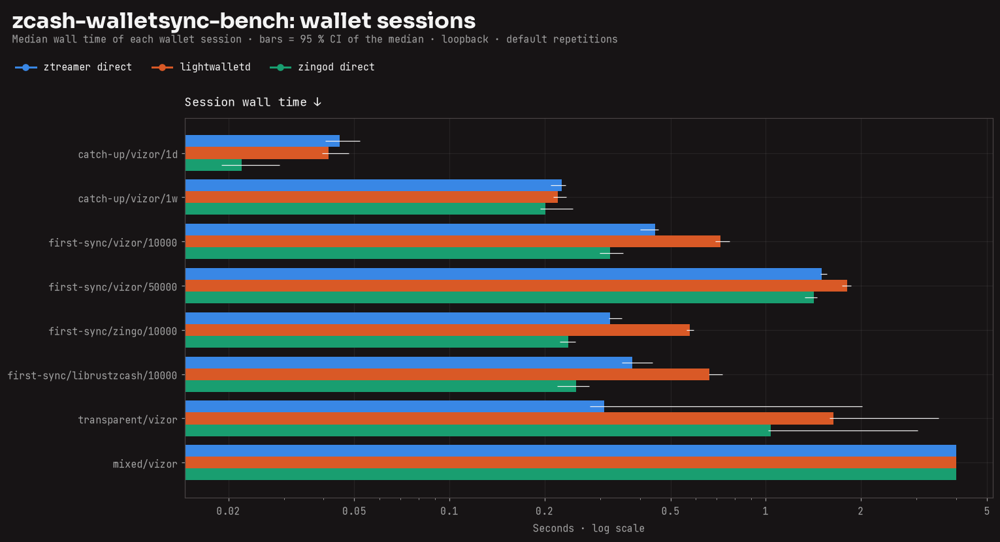

| Step | ztreamer direct p50 [95 % CI] | lightwalletd p50 [95 % CI] | zingod direct p50 [95 % CI] |
| --- | --- | --- | --- |
| app-open | 500 µs [450 µs, 500 µs] | 1.10 ms [1.00 ms, 1.20 ms] | 500 µs [500 µs, 500 µs] |
| catch-up/vizor/1h | 19.00 ms [18.50 ms, 19.00 ms] | 24.50 ms [24.00 ms, 25.00 ms] | 5.00 ms [4.00 ms, 5.50 ms] |
| catch-up/vizor/1d | 45.00 ms [40.50 ms, 52.00 ms] | 41.50 ms [39.50 ms, 48.00 ms] | 22.00 ms [19.00 ms, 29.00 ms] |
| catch-up/vizor/1w | 227 ms [208 ms, 234 ms] | 220 ms [212 ms, 234 ms] | 202 ms [194 ms, 245 ms] |
| first-sync/vizor/1000 | 207 ms [203 ms, 250 ms] | 516 ms [509 ms, 550 ms] | 92.00 ms [85.00 ms, 95.00 ms] |
| first-sync/vizor/10000 | 447 ms [401 ms, 457 ms] | 721 ms [693 ms, 769 ms] | 322 ms [298 ms, 354 ms] |
| first-sync/vizor/50000 | 1.50 s [1.49 s, 1.56 s] | 1.81 s [1.74 s, 1.86 s] | 1.42 s [1.33 s, 1.46 s] |
| first-sync/zingo/10000 | 322 ms [319 ms, 350 ms] | 574 ms [563 ms, 593 ms] | 238 ms [223 ms, 250 ms] |
| first-sync/librustzcash/10000 | 378 ms [351 ms, 438 ms] | 665 ms [660 ms, 730 ms] | 252 ms [219 ms, 276 ms] |
| enhance/vizor | 202 ms [202 ms, 202 ms] | 202 ms [201 ms, 202 ms] | 202 ms [201 ms, 202 ms] |
| enhance/zingo | 202 ms [202 ms, 202 ms] | 202 ms [201 ms, 202 ms] | 202 ms [202 ms, 202 ms] |
| transparent/vizor | 309 ms [278 ms, 2.02 s] | 1.64 s [1.59 s, 3.52 s] | 1.04 s [1.02 s, 3.03 s] |
| mixed/vizor | 4.00 s [4.00 s, 4.00 s] | 4.00 s [4.00 s, 4.00 s] | 4.00 s [4.00 s, 4.00 s] |

**Scale**: aggregate MB/s of parallel wallets (median).

| Wallets | ztreamer direct MB/s | lightwalletd MB/s | zingod direct MB/s |
| --- | --- | --- | --- |
| 1 | 7.2 | 2.4 | 2.5 |
| 2 | 14.4 | 4.9 | 4.9 |
| 4 | 28.8 | 9.8 | 9.8 |
| 8 | 37.6 | 15.6 | 16.7 |

## Wallets at once: cbb

cbb starts N wallets at once, each on its own connection, and has each wallet fetch 50 GetBlockRange of 100 blocks from height 2,000,000. In tree mode each wallet also asks GetTreeState every 5 ranges; BlockRange-only mode skips that. Each level runs a cold pass and then a warm pass. "ok req/s" counts successful requests only. Each level takes a few seconds, so these numbers vary more than those of the native suite.

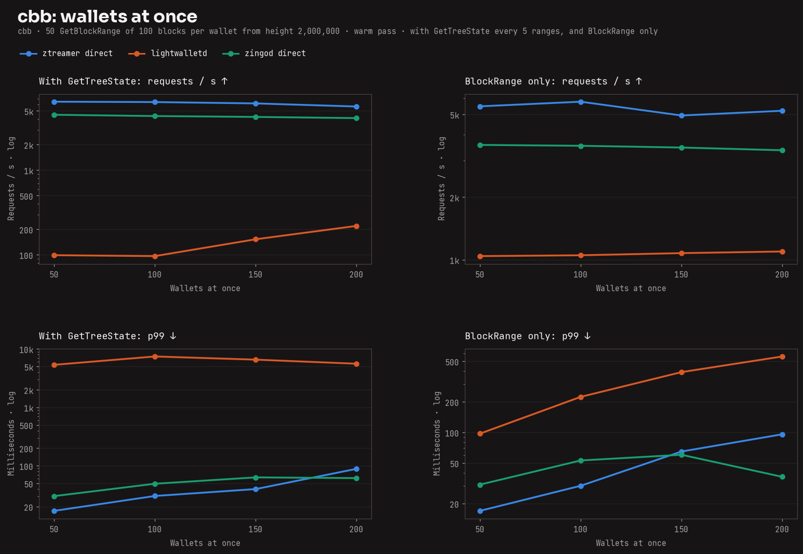

**GetBlockRange with GetTreeState every 5 ranges**

| Wallets | Pass | ztreamer direct ok req/s | ztreamer direct p50 | ztreamer direct p99 | ztreamer direct errors / requests | lightwalletd ok req/s | lightwalletd p50 | lightwalletd p99 | lightwalletd errors / requests | zingod direct ok req/s | zingod direct p50 | zingod direct p99 | zingod direct errors / requests |
| --- | --- | --- | --- | --- | --- | --- | --- | --- | --- | --- | --- | --- | --- |
| 50 | cold | 6,889 | 7.04 ms | 17.87 ms | 0 / 3,000 | 141 | 10.61 ms | 3.48 s | 0 / 3,000 | 4,361 | 10.35 ms | 28.98 ms | 0 / 3,000 |
| 50 | warm | 6,429 | 7.88 ms | 16.93 ms | 0 / 3,000 | 99 | 9.21 ms | 5.35 s | 0 / 3,000 | 4,507 | 10.16 ms | 30.29 ms | 0 / 3,000 |
| 100 | cold | 6,739 | 15.86 ms | 29.77 ms | 0 / 6,000 | 101 | 9.52 ms | 6.96 s | 27 / 6,000 | 4,274 | 22.89 ms | 51.36 ms | 0 / 6,000 |
| 100 | warm | 6,365 | 17.04 ms | 30.45 ms | 0 / 6,000 | 97 | 9.45 ms | 7.44 s | 25 / 6,000 | 4,352 | 23.12 ms | 49.31 ms | 0 / 6,000 |
| 150 | cold | 5,894 | 27.12 ms | 62.46 ms | 0 / 9,000 | 147 | 12.34 ms | 6.66 s | 625 / 9,000 | 4,334 | 30.67 ms | 57.18 ms | 1,320 / 9,000 |
| 150 | warm | 6,136 | 27.54 ms | 39.97 ms | 0 / 9,000 | 153 | 11.84 ms | 6.57 s | 638 / 9,000 | 4,249 | 30.73 ms | 63.39 ms | 1,320 / 9,000 |
| 200 | cold | 5,635 | 39.01 ms | 80.96 ms | 0 / 12,000 | 203 | 45.15 ms | 6.14 s | 1,233 / 12,000 | 4,221 | 28.80 ms | 70.02 ms | 5,809 / 12,000 |
| 200 | warm | 5,640 | 38.27 ms | 88.70 ms | 0 / 12,000 | 219 | 50.62 ms | 5.59 s | 1,270 / 12,000 | 4,115 | 25.07 ms | 61.57 ms | 7,773 / 12,000 |

**GetBlockRange only**

| Wallets | Pass | ztreamer direct ok req/s | ztreamer direct p50 | ztreamer direct p99 | ztreamer direct errors / requests | lightwalletd ok req/s | lightwalletd p50 | lightwalletd p99 | lightwalletd errors / requests | zingod direct ok req/s | zingod direct p50 | zingod direct p99 | zingod direct errors / requests |
| --- | --- | --- | --- | --- | --- | --- | --- | --- | --- | --- | --- | --- | --- |
| 50 | cold | 5,689 | 8.20 ms | 17.45 ms | 0 / 2,500 | 1,076 | 43.81 ms | 93.82 ms | 0 / 2,500 | 3,688 | 12.62 ms | 30.54 ms | 0 / 2,500 |
| 50 | warm | 5,469 | 8.78 ms | 16.96 ms | 0 / 2,500 | 1,042 | 44.54 ms | 97.28 ms | 0 / 2,500 | 3,569 | 13.05 ms | 30.70 ms | 0 / 2,500 |
| 100 | cold | 5,676 | 17.47 ms | 26.29 ms | 0 / 5,000 | 1,056 | 83.97 ms | 232 ms | 0 / 5,000 | 3,503 | 20.59 ms | 59.58 ms | 2,578 / 5,000 |
| 100 | warm | 5,757 | 16.96 ms | 29.92 ms | 0 / 5,000 | 1,052 | 84.86 ms | 224 ms | 0 / 5,000 | 3,534 | 17.33 ms | 53.05 ms | 3,087 / 5,000 |
| 150 | cold | 5,242 | 27.77 ms | 45.02 ms | 0 / 7,500 | 1,071 | 119 ms | 388 ms | 0 / 7,500 | 3,577 | 15.39 ms | 39.33 ms | 5,920 / 7,500 |
| 150 | warm | 4,943 | 29.17 ms | 64.96 ms | 0 / 7,500 | 1,077 | 118 ms | 392 ms | 0 / 7,500 | 3,467 | 17.18 ms | 60.35 ms | 5,785 / 7,500 |
| 200 | cold | 5,667 | 35.45 ms | 46.24 ms | 0 / 10,000 | 1,102 | 148 ms | 556 ms | 0 / 10,000 | 3,309 | 18.21 ms | 68.16 ms | 8,196 / 10,000 |
| 200 | warm | 5,207 | 36.29 ms | 95.94 ms | 0 / 10,000 | 1,097 | 149 ms | 558 ms | 0 / 10,000 | 3,363 | 13.56 ms | 36.64 ms | 8,840 / 10,000 |

## Failures and errors

- **zingod, 128 and 256 clients** (serving suite, both request sizes, all four zingod runs): the warmup failed with `transport error`, so these levels have no throughput. At the same time the zingod log counts refused connections, for example `level=warn message=Serving rps=86638.98 conns=64 conns_refused=673 component=Grpc`. The default `max_connections_per_ip` of zingod 1.1.0 is 128 (`packages/zingod-grpc/src/limits.rs`). In ghz at 256 workers, zingod direct failed 2,065,839 GetTreeState requests and 2,262,202 GetLatestBlock requests, with log lines such as `refused=2852988 at_capacity=2852988 conns_refused=676`.
- **zingod, cbb**: from 100 wallets in BlockRange-only mode and from 150 in tree mode, zingod answered `Unavailable: work stream limit reached` with `grpc-retry-pushback-ms: 250`. Errors in the warm pass: 3,087 of 5,000 requests at 100 wallets, 5,785 of 7,500 at 150 and 8,840 of 10,000 at 200 (BlockRange only); 1,320 of 9,000 at 150 and 7,773 of 12,000 at 200 (tree mode).
- **lightwalletd**: the 100-block concurrency suite failed at 128 and 256 clients, with 20 and 138 errors of the form `too many requests being received at once; retry shortly`. In cbb's tree mode, GetTreeState failed with `z_gettreestate failed: status code: 429, response: "Too many connections...` from zakurad from 100 wallets on: 25, 638 and 1,270 errors in the warm passes at 100, 150 and 200 wallets. In ghz at 256 workers, lightwalletd failed 525,734 GetTreeState requests and 14,095 GetLatestBlock requests.
- **ztreamer**: 264 of about 84 million ghz requests over both ztreamer runs failed with `Unavailable: serving snapshot generation N does not match LMDB generation N+1`, which ztreamer returns when a new block is committed while it serves the request. Per ghz file: ztreamer direct GetSubtreeRoots at 256 workers 102, GetBlockNullifiers at 256 workers 85, at 64 workers 12 and at 1 worker 1, GetBlock at 16 workers 2; ztreamer snapshot GetSubtreeRoots at 64 workers 40, GetTreeState at 256 workers 19 and at 16 workers 3. There was no `MDB_READERS_FULL` in any run.
- **All servers, ghz**: each ghz level ends with a few errors of the form `use of closed network connection`, one for each worker that was still reading when ghz closed its connections.
- **Harness**: in the first wallet run (ztreamer direct), the soak scenario of zcash-walletsync-bench was stopped with SIGTERM (exit code 143), and its summary was rebuilt from the raw files with its `report` command. After that run, an exit status in the offload helper stopped `run-all.sh`; the outputs of the run were complete, so it was marked done and the remaining runs went on. The `trees_height` column of ztreamer direct's `resources.csv` is empty, because the helper that reads it was built during that run. The node tip at the start of each run comes from `run-all.log` (`node-tip-start.txt` in each run directory), because `record_env` had read it before the node started.

## Raw data

Site page: `site/benchmarks.html`. Data: `site/benchmarks/2026-11-18/` (summary.csv, samples.csv, ghz.csv, wallet.csv, resources.csv, disk.csv, phases.csv, numbers.json, SVG and PNG plots). Harness: `benchmarks/2026-11-v0.2.0-blog/harness/` (run-all.sh, run-main.sh, run-restart.sh, run-wallet.sh, serve.sh, sample.py, report.py, page.py) and `meta.json`. Full run directories with every log and the raw zcash-walletsync-bench (in lwb/) and cbb output: `~/bench-2026-11/blog/runs/` (five labels, their -restart runs, and the -wallet runs of ztreamer-direct, lightwalletd and zingod-direct).
